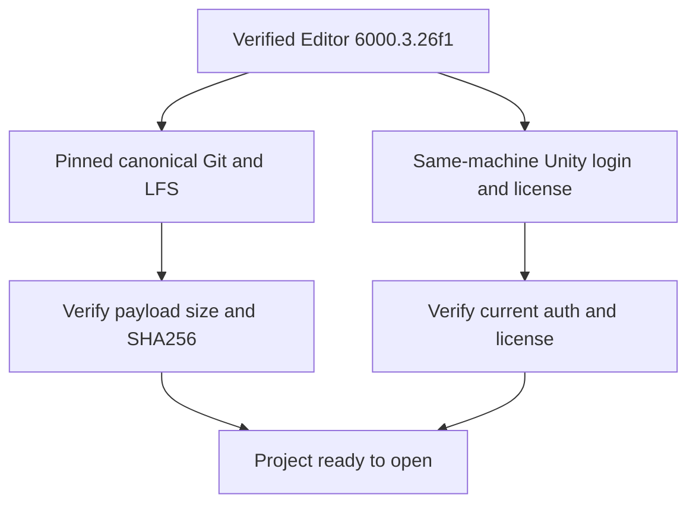

# Termux CCF / CD: one active Cloudflare connection and automatic Codespace setup

This is the current account-switch runbook for
`sundamunda289-art/Unity-Game-Aris`, branch `main`. It describes the repository
implementation, not a claim that the commands have already been installed on
the owner's phone or run successfully against a live account. The
[current AGENTS.md policy](../AGENTS.md) takes precedence over historical
account-switch examples elsewhere in the repository.

The phone keeps one selected active Cloudflare connection. `CCF` prepares a
Cloudflare account and connects the current Codespace when possible. `CD`
selects the Codespace hosting account, verifies the private bridge, then runs
the Editor-first source and license setup. Official browser approval is still
required when GitHub, Cloudflare or Unity needs a new authorization.

## Install the commands once in Android Termux

Run this block after this implementation is available on canonical `main`:

```bash
(
  set -e
  pkg install -y curl coreutils
  AARIS_INSTALLER_PATH="$(mktemp "${TMPDIR:-$PREFIX/tmp}/aaris-install.XXXXXXXX")"
  trap 'rm -f -- "$AARIS_INSTALLER_PATH"' EXIT
  curl -fsSL --retry 3 \
    https://raw.githubusercontent.com/sundamunda289-art/Unity-Game-Aris/main/Tools/Codespaces/install_termux_commands.sh \
    -o "$AARIS_INSTALLER_PATH"
  bash -n "$AARIS_INSTALLER_PATH"
  bash "$AARIS_INSTALLER_PATH"
) && source "$HOME/.bashrc"
```

The installer downloads a named set of scripts from one resolved canonical
commit, validates shell/Python syntax, records `SOURCE_SHA`, and switches its
`current` link only after the release is complete. It adds the interactive
functions to `.bashrc` once and keeps a private backup before editing that
file. A symlinked `.bashrc` is preserved and requires the printed source line
to be added manually. Installing the commands does not change an account,
deploy a Worker or prove a Codespace is ready.

Termux dependencies include Python, GitHub CLI, curl, jq, coreutils,
util-linux and proot-distro. The first `CCF` also prepares a reusable PRoot
Linux guest for Cloudflare tooling. This initial Linux/package download can
take time and phone storage; it does not require an already-running
Codespace. Subsequent invocations reuse that guest and verified tooling.

## Everyday commands

| Command | Behavior |
| --- | --- |
| `CCF` | Start a Cloudflare account switch, or resume its unfinished operation. |
| `CF` or `cf` | Exactly the same controller as `CCF`. |
| `CD` | Start a Codespace hosting-account selection and full setup, or resume its unfinished operation. |
| `CD --resume` | Resume a pending Codespace operation, or reuse the saved current hosting profile. |
| `CD --status` | Show saved operation state and attempt to read remote provisioning state. |
| `cd` | In interactive Bash, run the same Codespace operation as `CD`. |
| `cd --status` / `cd --resume` | Interactive lowercase equivalents of the corresponding `CD` options. |
| `cd path`, `cd ..`, `cd ~`, `cd -` | Normal Bash directory navigation. |

The `cd` function is installed only in interactive Bash and is not exported.
Noninteractive scripts keep the shell builtin. Use `cd ~` or `builtin cd`
when you want Bash's original no-argument home navigation.

After a completed `CD`, another plain `CD` starts a new hosting-account
selection. While an operation is unfinished, repeat its original command;
the controller uses the recorded operation and source revision. A different
kind of switch is refused while its connection outcome needs reconciliation.
There is one deliberate exception: once `CD` has committed its connection,
`CCF` can run while detached Unity/LFS setup is still pending. That setup is
retained as a separate `project_operation`. A later `CD` resumes it when it
belongs to the same active machine and the desired broker is `CONNECTED`.
If `CCF` instead recorded `CF_READY_CODESPACE_PENDING`, `CD` can select a new
hosting destination. Do not delete receipts or start duplicate bootstraps
to force these transitions.

## What CCF verifies before changing the active connection

1. Verify the canonical owner GitHub profile and stage any new account
   credentials separately from the active profiles.
2. Authorize Cloudflare through the phone flow and deploy the candidate from
   the operation's immutable source. If the authorized identity has several
   Cloudflare accounts, select the intended account explicitly.
3. Check the authenticated broker protocol, random challenge, deployment
   operation and source revision. An HTTP 200 from `/health` alone is not a
   working command-channel proof.
4. When an exact existing Codespace is reachable, prepare its candidate agent,
   verify the restricted candidate command path, request explicit commit and
   reconcile the remote transaction receipt. Publish the active connection
   only after the remote handover is confirmed.
5. Record any optional cleanup still needed and retry it later. A cleanup
   failure does not automatically undo a verified connection.

A candidate can exist while the old connection remains selected. This is a
staging and recovery mechanism, not a three-account rotation system. There
is no requirement to save three API tokens or Unity passwords in a vault.

After selection changes, an old Worker can still physically exist. A
`previous_connection` record with `selected=false` means the controller no
longer selects that connection; it does not prove that every old Worker was
deleted or an unreachable agent stopped. If retirement cannot be verified,
its receipt remains `PENDING`. Even `AGENT_HANDOVER_VERIFIED` records the
specific same-machine handover, not global cleanup across accounts.

### Cloudflare ready while Codespace is unavailable

`CCF` can prepare Cloudflare even if the old Codespace is stopped, unavailable
or cannot be reached using the current hosting account. Its recorded result
is then `CF_READY_CODESPACE_PENDING`. The controller saves the desired
`AARIS_NEXT_BROKER_URL`; it leaves the active `AARIS_BROKER_URL` and active
machine configuration unchanged.

Run `CD` to choose the authorized destination and complete the connection.
The pending result proves a prepared Cloudflare endpoint, not an online
Codespace, Unity installation or licensed project.

## What CD does, in the required order

The controller keeps canonical-owner and Codespace-hosting GitHub credentials
in separate phone profiles. It stages the new hosting login instead of
logging out the working profile first. It selects an exact eligible
`*/Unity-Game-Aris` machine. A single Available machine is reused. When the
existing choice is stopped, or multiple machines exist, the selection menu
offers numbered machines and **0 = create a new minimal Codespace**. Existing
Codespaces are preserved. If the selected account has no eligible machine,
the bootstrap creates a minimal one subject to that account's quota.

New creation uses the **hosting user's token** against the canonical public
repository and its reviewed minimal devcontainer pinned to runtime
`SOURCE_SHA`. Codespace ownership follows the hosting user; it does not
require creating a fork or running a stale fork's startup hooks. The game
revision is subsequently advanced safely to the separately pinned
`project_sha` by the provisioner.

An already-Available authorized machine can be reused without a restart.
An older stopped machine is not automatically started when the bootstrap
cannot prove its startup configuration safe; it returns
`TURBO_EXISTING_STARTUP_REVIEW_REQUIRED`. Choose **0** during destination
selection when a fresh minimal machine is intended. Reusing a stopped
legacy machine requires deliberate startup review/migration rather than
bypassing this gate or deleting its source.

The hosting repository can differ from the canonical game repository.
Project source always comes from
`sundamunda289-art/Unity-Game-Aris/main`. The canonical deploy private key is
generated inside the selected Codespace; only its public key is registered
with canonical GitHub. The master account token stays on the phone.

After the private bridge has passed its transaction checks, provisioning
runs as a detached process on that exact machine:



### 1. Verify or finish the Editor installation

Before source hydration, verify Unity **6000.3.26f1**. A valid existing Editor
is reused. A new installation must finish through the official installer,
report the expected executable version, contain required Editor files and
have its durable completion marker. Merely finding an executable left by
an interrupted install is insufficient.

The current provisioning path expects Ubuntu 22.04 and installs required
packages in sequence. The transactional bridge does not launch a competing
detached GUI package installer. Editor installation and LFS work share a
heavy-operation lock. The updated devcontainer hooks initialize Git LFS with
skip-smudge and do not start a separate LFS-first download. These hooks do
not control every GitHub-platform clone step before the container starts.

### 2. Hydrate the pinned canonical source

Only after `editor_ready` does the provisioner fetch the pinned game revision
and inventory its LFS pointers. It downloads the target revision's missing
objects with `lfs.concurrenttransfers=1`, before changing the working
checkout. It then permits only a safe fast-forward, performs explicit LFS
checkout, and checks every target payload's declared size and SHA256.
Historical `git lfs fetch --all` is not part of this setup.

Disk preflight accounts for the LFS object cache, materialized working files,
largest temporary object, normal Git files, safety margin and available
inodes. Single-stream transfers reduce competing disk work; they do not
remove the storage required for both the cache and the working copy. A
failed download can be retried without automatically deleting the existing
Editor, assets or cache.

Preservation rules apply throughout:

- Dirty tracked source, divergent history, hidden tracked-file flags and an
  existing Editor on this project pause automatic synchronization.
- Existing modified tracked and nonignored untracked entries are fingerprinted
  and checked. `git merge --ff-only --no-overwrite-ignore` also refuses an
  ignored untracked file collision instead of replacing it.
- The process never automatically resets, cleans, stashes, creates a worktree,
  force-checks out files or resolves a merge conflict.

A pause preserves the user's work; it does not mean that work was included
in canonical main. Resolve the reported source conflict deliberately, then
resume the same operation.

### 3. Complete Unity authorization while LFS continues

Once the Editor is ready, the phone can run the known four-step recovery
flow while source download/verification continues remotely:

1. Check the exact selected Codespace and SSH/Python access.
2. Prepare the immutable reviewed Unity helper on that machine.
3. Start or reattach its single detached login session.
4. Wait for the fresh official Unity HTTPS link or already-valid completion.

Open the fresh link on the phone, sign in and approve it when requested.
Android opening/copying is a convenience, not proof that authorization
completed. A phone app switch or SSH interruption reconnects to the same
remote session rather than starting another CLI login. The actual Unity
provider session expiry controls renewal; the old artificial 420/570-second
whole-login deadlines are removed. Expired sessions receive a fresh link.
Individual network/SSH calls still have bounded transport timeouts.

Secure credential storage is the default. If the CLI reports that secure
storage is unavailable, the helper returns
`UNITY_SECURE_STORAGE_UNAVAILABLE` with exit **26**. The controller then
explains the limitation and asks once for explicit consent to
owner-restricted **unencrypted file-based credential storage on that exact
Codespace**. Only an affirmative answer enables
`AARIS_UNITY_INSECURE_STORAGE=1`, and that consent is saved privately for the
selected machine. It is not silently applied to a different Codespace.

If approval or activation remains incomplete, state is
`WAITING_FOR_UNITY_LOGIN`. Repeating `CD` resumes the same operation. The
remote source step may already be finished. No password/serial vault, copied
license file or authorization bypass is used. Fresh auth **and** license
checks on the selected machine are required for success.

### 4. Report readiness accurately

`COMPLETE` requires verified Editor, exact pinned canonical source with valid
LFS payloads, and current same-machine license status. `ready_to_open=true`
means those setup prerequisites passed. The provisioner reports
`project_opened=false`: it does not automatically import/open a project or
stop an existing Editor. Scene import, GUI rendering, Play Mode and Android
module/build validation need their own subsequent evidence.

## State, versions and interruptions

The phone stores private operation receipts under
`~/.config/aaris-ai/operations`. Installed command releases live under
`~/.local/share/aaris-switch/releases/<SOURCE_SHA>`. All mutating aliases
share one `switch.lock`; the lock inode is retained. A busy invocation does
not kill another process or remove its lock.

There are two distinct pinned revisions:

| Field | Meaning |
| --- | --- |
| Runtime `source_sha` / installed `SOURCE_SHA` | Reviewed controller, Worker and helper implementation used by this operation. |
| Operation `project_sha` | Canonical `main` game revision resolved at operation creation. |
| Provisioner's `--source-sha` / state `source_sha` | The game revision passed from `project_sha`, not the runtime release SHA. |

Resuming an operation reuses its installed runtime even if a newer phone
release was installed meanwhile. It does not silently mix helper versions
or move the target game revision halfway through a download. This also
applies when `CD` returns to an older separate `project_operation` after a
Cloudflare switch: the controller reexecutes that operation's pinned
installed release.

The remote provision journal and heavy runtime are private subdirectories
of the project's actual Git directory under `/workspaces`:
`aaris-provision` and `aaris-runtime`. They are outside tracked source.
Temporary per-operation logs live under private `/tmp` paths. New runtime
storage is persistent in the workspace; an already-verified legacy Editor
in the user's home can also be reused and reports that storage location.
The small provision helper bundle can be reconstructed if absent after a
rebuild. Remote helper and deploy-key paths are resolved through the
effective user's passwd home, avoiding a mismatched inherited `$HOME`.
A rebuilt machine must still revalidate its current environment,
bridge, license and runtime; persistence is not a claim of a tested live
rebuild or transferable Unity authorization.

Ctrl+C stops the phone's current operation/monitor and performs scoped
cleanup where the outcome is known. Detached provisioning and login can
survive a phone disconnect. If a remote commit may already have happened,
the controller retains the receipt and reconciles it instead of claiming
an instant rollback. After a confirmed connection commit, stopping the
phone monitor does not undo the verified connection.

`CD --status` reads the recorded result and attempts a remote status query.
It is not a second installer. If the remote query fails, its last saved
state is not proof that the process is currently alive; reconnect and
resume the original command. Codespace shutdown, quota and network failures
can still prevent progress.

## Progress and safe error reports

The scripts show stages and measured elapsed time; long downloads do not
have a five-second whole-task deadline or a fabricated percentage. Retries
are bounded for individual retryable operations. Login prompts and expired
permissions still require the owner's actual authorization.

On failure, the copyable error box contains canonical repository/branch,
failed step, fixed reason code, exit/HTTP code when known, and up to **15
allowlisted recent events**. Raw stderr, tokens, arbitrary exception text,
private JSON and OAuth links are excluded. Login URLs are displayed only
in the owner's phone login flow, outside that box. Share the safe box for
diagnosis; do not paste private logs or authorization links into chat,
GitHub Issues, public Actions logs or commits.

An uncertain workflow dispatch or remote commit is reconciled using its
operation ID before another request. Optional cleanup has its own pending
receipt. Network loss does not justify deleting a journal, broad `pkill`,
resetting source or asserting that the remote action never happened.

## Validation and implementation references

Local tests exercise mocked providers and real temporary Git/LFS fixtures.
They cover ordering, detached-operation attachment, retained locks,
interruption boundaries, candidate/commit state, source preservation
(including ignored-file collisions), LFS corruption/pointer detection,
secure-storage exit 26, session expiry and four-step phone behavior. They
do not install Unity or activate a real license, execute a real phone
PRoot deployment, prove live Cloudflare/GitHub access, or render the game.

Relevant suites can be run locally without credentials:

```bash
python3 Tools/Codespaces/test_provision_codespace.py
python3 Tools/Codespaces/test_switch_controller.py
```

The integration workflow also runs the transaction and Cloudflare protocol
suites. Report the actual suite results separately from a later live test.
Live readiness needs the exact selected machine, current authenticated
broker command result, provision state, current license checks and—when
requested—real Editor/scene/build evidence.

Implementation entry points:

- [Command installer](../Tools/Codespaces/install_termux_commands.sh),
  [interactive functions](../Tools/Codespaces/termux_functions.sh) and
  [shared controller](../Tools/Codespaces/switch_controller.py).
- [Cloudflare phone runner](../Tools/Codespaces/termux_cf_runner.sh) and
  [transaction installer](../Tools/Turbo/transaction_install.py).
- [Detached provisioner](../Tools/Codespaces/provision_codespace.py),
  [Editor installer](../Tools/Codespaces/install_unity.sh) and
  [LFS verifier](../Tools/Codespaces/verify_lfs.py).
- [Four-step phone login](../Tools/Codespaces/termux_unity_login_recover.sh)
  and [same-machine login sessions](../Tools/Codespaces/mobile_license.py).
- [Canonical Git bridge reference](CANONICAL_CODESPACE_GIT_SYNC.md) and
  [Turbo command-channel reference](AARIS_TURBO_TERMINAL.md).
